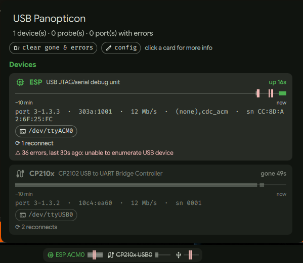

# USB Panopticon

A bench USB watcher for board bring-up (ESP32, RP2350, …), replacing a permanently open `dmesg -wH`.

Features:

* Small python daemon tracking event stream from 2 sources:
  * `udev netlink monitor` - monitors the events after setting kernel-side filter for relevant subsystems.
  * kernel log via the journal - detects flaky usb connections (the dreaded `-71` error messages)
* [DankMaterialShell](https://github.com/AvengeMedia/DankMaterialShell) bar widget (niri).
* small timeline bar for events per detected MCU/UART board
* general USB errors timeline bar
* additional relevant info on left-click
* "port cycle" (or power cycle on compatible USB hubs) usb port by press-and-hold right mouse button on port name for 1 second
* config device rules by TOML config
* double left click on a bar entry opens a terminal on its tty (`terminal_cmd` in the config, default `alacritty -e picocom {port} --baud 115200`)
* CLI available: `usb-panopticon ls | watch | wait esp --new | cycle PORT`.

Install, rules and internals: [docs/details.md](docs/details.md).

**Disclaimer:** this code was generated by an LLM.

License: [MIT](LICENSE).
